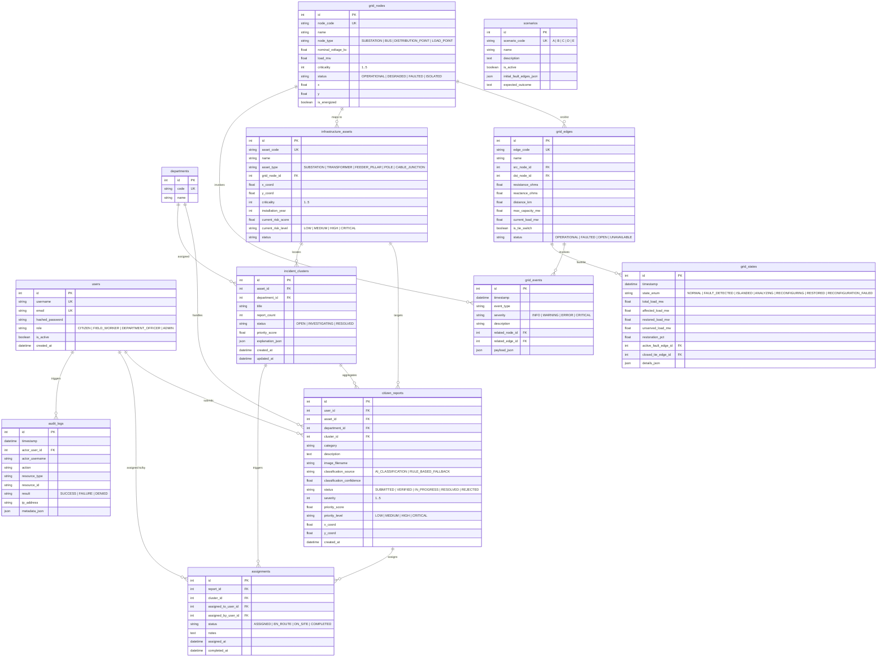

# CivicGrid Entity Relationship Model (ERD)

## 1. Schema Diagram (Mermaid)

---

## 2. Integrity Constraints & Rules

1. **Foreign Key Cascades**:
   - `grid_edges.src_node_id` & `dst_node_id` reference `grid_nodes.id` (RESTRICT on delete).
   - `infrastructure_assets.grid_node_id` references `grid_nodes.id` (SET NULL on delete).
   - `citizen_reports.user_id` references `users.id` (RESTRICT on delete).
2. **Check Constraints**:
   - `grid_nodes.criticality` BETWEEN 1 AND 5.
   - `grid_nodes.load_mw` >= 0.0.
   - `grid_edges.max_capacity_mw` > 0.0.
   - `grid_edges.current_load_mw` >= 0.0.
   - `citizen_reports.severity` BETWEEN 1 AND 5.
   - `citizen_reports.priority_score` BETWEEN 0.0 AND 100.0.
   - `grid_states.restoration_pct` BETWEEN 0.0 AND 100.0.
3. **Indexes**:
   - `grid_edges`: `(src_node_id, dst_node_id)`, `status`, `is_tie_switch`
   - `citizen_reports`: `user_id`, `asset_id`, `department_id`, `cluster_id`, `created_at`
   - `audit_logs`: `timestamp`, `actor_user_id`, `action`
   - `incident_clusters`: `asset_id`, `department_id`, `status`
